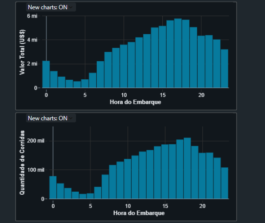

# 🚕 NYC Taxi Data Pipeline

## 📌 Sobre o projeto

Projeto prático de Engenharia de Dados desenvolvido
com Databricks, Python, PySpark e Delta Lake.

O objetivo é construir um pipeline de dados utilizando
registros reais de corridas de táxi de Nova York,
disponibilizados pela NYC Taxi & Limousine Commission.

O projeto utiliza a arquitetura Medallion, organizada
nas camadas Bronze, Silver e Gold, para investigar
a qualidade dos dados e produzir indicadores analíticos.

## 🎯 Objetivos

- Processar dados reais no Databricks.
- Investigar inconsistências e valores nulos.
- Implementar a arquitetura Bronze, Silver e Gold.
- Criar indicadores de corridas e valores financeiros.
- Desenvolver um dashboard para visualização dos resultados.

## 🏗️ Arquitetura do Pipeline

O projeto utiliza a arquitetura Medallion,
dividida em três camadas:

### 🥉 Bronze — Dados Brutos

- Ingestão do arquivo Parquet original.
- Armazenamento no Unity Catalog.
- Criação de uma tabela Delta Lake.
- Preservação dos 2.964.624 registros originais.

Tabela: `workspace.default.bronze_nyc_taxi`

### 🥈 Silver — Qualidade dos Dados

- Identificação de distâncias zeradas ou negativas.
- Classificação de passageiros não informados.
- Identificação de horários inconsistentes.
- Classificação de valores financeiros.
- Preservação dos registros para análise.

Tabela: `workspace.default.silver_nyc_taxi`

### 🥇 Gold — Indicadores Analíticos

- Quantidade de corridas por hora.
- Soma dos valores positivos por hora.
- Preparação dos dados para visualização.

Tabelas:
- `workspace.default.gold_nyc_taxi_horarios`
- `workspace.default.gold_nyc_taxi_faturamento`

## 🔍 Análise de Qualidade dos Dados

Foram analisados 2.964.624 registros de corridas
de táxi de Nova York referentes a janeiro de 2024.

### Resultados da investigação

| Verificação | Registros |
|---|---:|
| Passageiros não informados | 140.162 |
| Distâncias iguais a zero | 60.371 |
| Valores totais negativos | 35.504 |
| Valores totais iguais a zero | 416 |
| Horários invertidos | 56 |
| Corridas com duração zero | 814 |
| Registros inteiramente duplicados | 0 |

### Estratégia de tratamento

Na camada Silver, foram criadas quatro colunas:

- `status_distancia`
- `status_passageiros`
- `status_horario`
- `status_financeiro`

As classificações permitem identificar registros
suspeitos sem excluir ou modificar os dados originais.

Os registros negativos podem representar ajustes
financeiros, enquanto horários inconsistentes
podem indicar problemas na coleta dos dados.

Essas situações exigem investigação antes
da aplicação de regras definitivas de tratamento.

Observação: um mesmo registro pode apresentar
mais de uma inconsistência.

## 📊 Resultados e Indicadores

A camada Gold foi utilizada para produzir
indicadores analíticos das corridas de janeiro de 2024.

### Indicadores principais

| Indicador | Resultado |
|---|---|
| Corridas com valor positivo e horário válido | 2.927.888 |
| Soma dos valores positivos selecionados | US$ 80.307.731,23 |
| Valor médio das corridas selecionadas | US$ 27,43 |
| Distância média com filtros adicionais | 3,73 milhas |
| Horário com maior quantidade de corridas | 18h |
| Horário com maior soma de valores | 17h |

### Principais descobertas

O horário das 18h apresentou a maior quantidade
de corridas, com 210.262 registros.

Entretanto, o maior valor financeiro registrado
ocorreu às 17h, com aproximadamente US$ 5,76 milhões.

Isso demonstra que o horário com maior quantidade
de viagens não é necessariamente aquele com
maior valor financeiro.

### Critérios utilizados

Os indicadores financeiros consideraram corridas
com valor total positivo e horário válido.

Para o cálculo da distância média, também foram
consideradas apenas corridas com distância positiva.

Os resultados não representam o faturamento líquido
da operação, pois não incluem os registros negativos
e outros possíveis ajustes financeiros.

## 📈 Dashboard de Análise

O dashboard foi desenvolvido no Databricks
para visualizar os indicadores da camada Gold.

Ele apresenta:

- Quantidade de corridas por hora de embarque.
- Soma dos valores positivos por hora.
- Comparação dos horários de maior movimento.

### Visualização do Dashboard

## 🛠️ Tecnologias Utilizadas

- Python
- PySpark
- Databricks Free Edition
- Apache Spark
- Delta Lake
- SQL (tecnologia de consulta; não utilizada diretamente nas etapas documentadas)
- Unity Catalog
- Visual Studio Code
- GitHub (publicação do repositório)

## 📂 Fonte dos Dados

Os dados utilizados neste projeto são registros públicos
de corridas de táxis amarelos de Nova York,
referentes a janeiro de 2024.

Fonte oficial:
[NYC Taxi & Limousine Commission](https://www.nyc.gov/site/tlc/about/tlc-trip-record-data.page)

Arquivo utilizado:
`yellow_tripdata_2024-01.parquet`

Os dados originais não estão incluídos no repositório.
